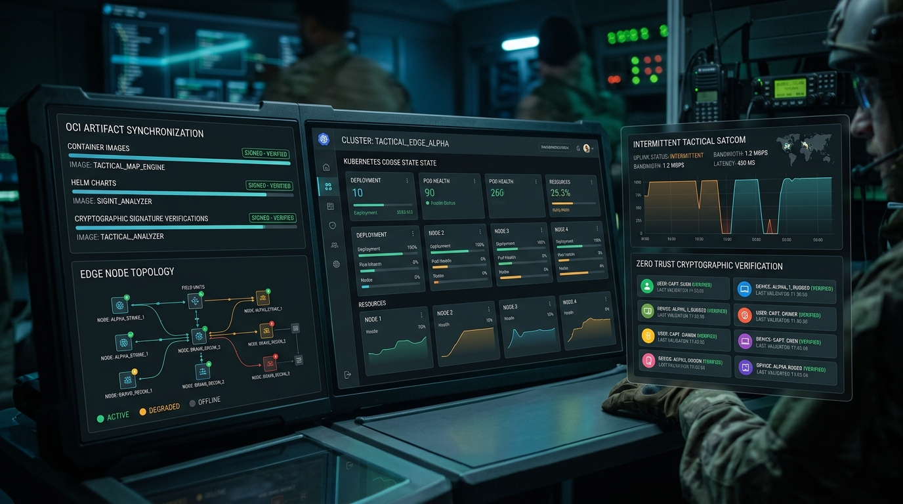

<figure class="post-figure">
  
  <figcaption>CLUSTER_MODE: EDGE_AUTONOMOUS — LINK_STATE: DDIL_OFFLINE — RECONCILIATION: LOCAL_SYNC — DRIFT: 0%</figcaption>
</figure>

**The Big Picture:** Enterprise GitOps relies on high-speed, continuous internet links to pull manifests from GitHub and container images from centralized registries. At the tactical edge — in forward operating bases, naval vessels, and airborne platforms — connectivity is Disconnected, Intermittent, and Low-Bandwidth (DDIL). Applying cloud-native GitOps to the edge requires shifting from centralized pull architectures to resilient, peer-distributable artifact stores.

---

### Why It Matters

When communication links are jammed or intentionally severed, tactical platforms cannot stall because an edge node failed an external image pull. Software delivery at the edge must be autonomous: workloads must boot, self-heal, and continuously enforce security policies from local state without reaching back to a distant cloud.

### The Details

- **Cloud-dependent reconciliation breaks at the edge:** Standard continuous delivery loops that expect continuous access to centralized Git servers fail immediately during network degradation.
- **Packages must be self-contained OCI artifacts:** Packaging container images, Helm charts, and cryptographic signatures into standard [Open Container Initiative (OCI)](https://opencontainers.org/) bundles (using tools like Defense Unicorns' [Zarf](https://zarf.dev/)) allows zero-dependency deployment over constrained radios or physical media.
- **Local controllers handle drift without remote consensus:** In-cluster GitOps engines (such as [Flux](https://fluxcd.io/) or [Argo CD](https://argo-cd.readthedocs.io/) edge configurations) must reconcile against local embedded repositories and cached state.
- **Audit evidence must buffer locally:** Telemetry and compliance proofs generated during disconnected operations must queue securely for asynchronous sync to feed [Continuous ATO (cATO)](/2026-07-12-continuous-ato-in-practice/) pipelines once connectivity restores.

---

## Go Deeper

### The Fallacy of Continuous Connectivity

In [Tactical Data Sharing and Zero Trust ICAM](/2026-07-26-tactical-data-sharing-coalition-icam/), we explored how multi-domain operations require moving trust verification to the API and object layer. Software deployment faces the exact same constraint: you cannot assume an unbroken pipe back to enterprise infrastructure.

In a contested electromagnetic environment, tactical networks routinely experience:
1. **Asymmetric Bandwidth:** Downlinks limited to single-digit kilobits per second over tactical satellite (TACSAT) links.
2. **Emission Control (EMCON):** Situations where systems must operate entirely in radio silence without transmitting or requesting external traffic.
3. **Transient Partitions:** Disconnections lasting anywhere from minutes to weeks.

Attempting to run a standard `git pull` or pulling multiple gigabytes of container layers over these channels causes timeouts, partial rollouts, and cluster instability.

### Decoupling Edge Delivery with Air-Gapped OCI Bundles

To deploy reliably in DDIL conditions, the distribution artifact must bundle code, configuration, images, and validation metadata into a single immutable payload:

*   **Self-Contained OCI Packages:** [OCI Registries](https://github.com/opencontainers/distribution-spec) are not just for container layers. Packaging declarative manifests, Helm charts, and container tarballs into unified OCI bundles guarantees that every dependency needed to boot an edge capability arrives in a single transaction.
*   **Embedded Local Registries:** Edge nodes run lightweight, embedded container registries (such as CNCF [Distribution](https://distribution.github.io/distribution/) or [Zarf's](https://zarf.dev/) internal registry) directly on the local cluster control plane. Workloads pull images from `127.0.0.1:5000` rather than reaching out to enterprise registries like [DoD Iron Bank](https://p1.dso.mil/services/iron-bank) or [Harbor](https://goharbor.io/).
*   **Peer-to-Peer & Tactical Transport Sync:** When bandwidth is available, delta-synchronization tools (e.g., rsync-over-TACSAT or mesh replication) push only the binary diffs of changed layers rather than whole images.

### Local Reconcilers and Policy Engines

Standard enterprise GitOps treats the central Git repository as the active controller. At the edge, the local cluster must treat the embedded local mirror as its source of truth:

1.  **Local Git / OCI Sources:** GitOps operators (like [Flux](https://fluxcd.io/)) are configured to watch local OCI repositories or on-node bare Git repos.
2.  **Autonomous Drift Correction:** If an edge pod crashes or a local operator alters a configuration during a contingency, the local reconciliation loop restores the desired state without remote intervention.
3.  **Disconnected Policy Enforcement:** Security policies written in [Policy-as-Code](/2026-02-05-policy-as-code-devsecops/) engines (such as [Open Policy Agent](https://www.openpolicyagent.org/) or [Kyverno](https://kyverno.io/)) execute against local Admission Controllers, verifying digital signatures using [Cosign](https://docs.sigstore.dev/cosign/overview/) with embedded public keys before any container runs.

### Bridging Compliance: The Store-and-Forward Telemetry Loop

The challenge of deploying software in defense environments is that every update must generate compliance artifacts under [NIST SP 800-53](https://csrc.nist.gov/publications/detail/sp/800-53/rev-5/final) and DoD cATO requirements.

When an edge cluster operates in offline mode:
*   Audit logs, vulnerability scans from local engines, and mutation records are written to a cryptographically tamper-evident local log store.
*   Workload identities verified through [SPIFFE/SPIRE](https://spiffe.io/) (explored in our [Tactical Data Sharing](/2026-07-26-tactical-data-sharing-coalition-icam/) guide) sign local audit records.
*   When a data link is re-established, an asynchronous store-and-forward proxy drains the queued telemetry upstream, closing the loop with the enterprise security operations center without blocking real-time mission execution.

### The Bottom Line

GitOps at the edge is not about bringing the cloud to the battlefield — it is about engineering software delivery systems that assume the cloud does not exist. By packaging full application state into self-contained OCI bundles and relying on local reconciliation, tactical units maintain software dominance in any contested environment.
