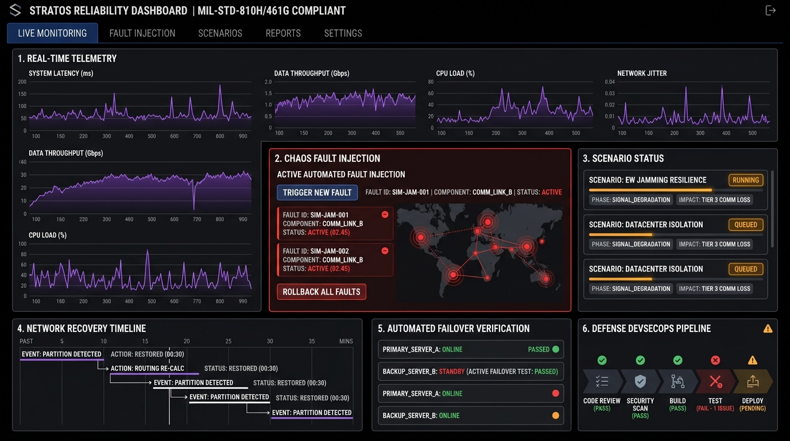

<figure class="post-figure">
  
  <figcaption>CHAOS_SCENARIO: EW_JAMMING_SIMULATION — PARTITION_STATE: ACTIVE — FAILOVER_LATENCY: 420ms — SYSTEM_STATE: RECOVERED</figcaption>
</figure>

**The Big Picture:** In commercial tech, an unexpected server outage causes dropped shopping carts or delayed notifications. In defense mission systems, an unhandled network partition or failover crash during a multi-domain operation can result in mission failure or loss of life. Yet traditional defense testing still relies on scheduled, manual "smoke tests" conducted in pristine lab environments. [Chaos engineering](https://principlesofchaos.org/) brings continuous, automated fault injection directly into defense CI/CD pipelines to mathematically prove system survivability before code ever deploys to the field.

---

### Why It Matters

High-assurance defense systems must be anti-fragile: they must not only withstand unexpected failures, but thrive and adapt when underlying infrastructure collapses. If your [Kubernetes](https://kubernetes.io/) cluster at the tactical edge has never experienced an unexpected radio jam, power loss, or packet corruption during automated testing, you do not have a resilient architecture—you have an untested assumption.

### The Details

- **Hope is not a reliability strategy:** Relying on standard unit and integration tests verifies that code works under ideal conditions; chaos engineering verifies that systems survive real-world chaos.
- **Simulating tactical degradation in software:** Cloud-native tools like CNCF [Chaos Mesh](https://chaos-mesh.org/) and [LitmusChaos](https://litmuschaos.io/) inject synthetic packet loss, high latency, DNS failures, and node panics into staging environments to replicate electronic warfare (EW) conditions.
- **Failover must be verified against strict SLAs:** Target-tracking and C2 services must fail over to redundant replicas within sub-second recovery thresholds without losing in-flight state.
- **Chaos experiments produce quantifiable [Continuous ATO (cATO)](/2026-07-12-continuous-ato-in-practice/) evidence:** Automated chaos experiment runs generate auditable proof of fault tolerance, satisfying key [NIST SP 800-53](https://csrc.nist.gov/publications/detail/sp/800-53/rev-5/final) contingency and reliability controls for [Continuous ATO (cATO)](/2026-07-12-continuous-ato-in-practice/).

---

## Go Deeper

### The Fallacy of Lab-Only Testing

Traditional defense acquisition programs conduct developmental test and evaluation (DT&E) by executing step-by-step procedures in static hardware integration laboratories. These test procedures follow rigid scripts where every dependency, network connection, and server node is healthy.

In the real world, tactical environments are defined by [DDIL conditions](/2026-08-08-tactical-edge-gitops-ddil/) and active electronic attacks:
1. **Asymmetric Packet Loss:** Uplinks dropping 60% of packets intermittently due to weather or directional antenna misalignment.
2. **Cascading Failures:** When a primary database node crashes under high load, reconnecting clients trigger a "thundering herd" effect that knocks out the backup instances.
3. **Split-Brain Scenarios:** Network partitions that cause distributed nodes to elect multiple conflicting leaders simultaneously.

```
+-------------------------------------------------------------------------+
|                  DEFENSE CI/CD CHAOS PIPELINE (STAGING)                 |
|                                                                         |
|  +--------------------+        +-------------------------------------+  |
|  | Standard CI Build  | -----> | Deploy Staging Cluster              |  |
|  | & Container Tests  |        | (Target Tracking / C2 Application)  |  |
|  +--------------------+        +------------------+------------------+  |
|                                                   |                     |
|                                                   v                     |
|                                +-------------------------------------+  |
|                                | Automated Chaos Controller          |  |
|                                | (Chaos Mesh / LitmusChaos)          |  |
|                                +------------------+------------------+  |
|                                                   |                     |
|                   +-------------------------------+------------------+  |
|                   |                                                  |  |
|                   v                                                  v  |
|  +---------------------------------+   +-----------------------------+  |
|  | Network Partition Injection     |   | Pod & Node Kill Injection   |  |
|  | * 2000ms latency spike          |   | * Corrupt primary DB pod    |  |
|  | * 50% packet drop (EW sim)      |   | * Cut node power instantly  |  |
|  +----------------+----------------+   +--------------+--------------+  |
|                   |                                   |                 |
|                   +-----------------+-----------------+                 |
|                                     |                                   |
|                                     v                                   |
|                   +-----------------------------------+                 |
|                   | Resiliency Verification Engine    |                 |
|                   | * State preserved? (PASS)         |                 |
|                   | * Failover &lt; 500ms? (PASS)        |                 |
|                   | * cATO Compliance Report Created  |                 |
|                   +-----------------------------------+                 |
+-------------------------------------------------------------------------+
```

### Implementing Tactical Chaos Scenarios

To build a meaningful defense chaos suite, engineering teams design experiments based on concrete mission threats:

#### 1. The Electronic Warfare (EW) Jamming Experiment
* **Hypothesis:** When tactical radio latency spikes from 15ms to 2,500ms and packet loss hits 40%, the frontline user interface must degrade gracefully to low-bandwidth text mode without crashing or blocking operator inputs.
* **Execution:** A `NetworkChaos` custom resource injects artificial jitter, delay, and packet drop into the egress traffic of the cluster's ingress gateway.
* **Verification:** The automated test runner asserts that message queues buffer locally and that UI state remains responsive.

#### 2. The Unannounced Node Termination Experiment
* **Hypothesis:** If a physical vehicle node experiences catastrophic power loss, container workloads automatically reschedule onto surviving nodes within 30 seconds with zero loss of persistent mission state.
* **Execution:** A `PodChaos` or `NodeChaos` resource forcefully sends a `SIGKILL` to the active target broker without graceful shutdown hooks.
* **Verification:** Automated probes check that distributed locks release cleanly and the backup replica assumes leadership without data corruption.

#### 3. Storage I/O Starvation
* **Hypothesis:** When encrypted disk writes become saturated during heavy sensor recording, mission-critical alerting threads must prioritize memory buffers and remain unblocked.
* **Execution:** An `IOChaos` program injects filesystem latency and random I/O write errors on the storage volume.

### Wiring Chaos Evidence into Continuous ATO

Under [NIST SP 800-53 Rev 5](https://csrc.nist.gov/publications/detail/sp/800-53/rev-5/final), defense systems must demonstrate compliance across several contingency and integrity families aligned with the [DoD Enterprise DevSecOps Reference Design](https://dodcio.defense.gov/Portals/0/Documents/Library/DoD-Enterprise-DevSecOps-Ref-Design-v2.0.pdf):
* **CP-10 (Information System Recovery & Reconstitution):** Verifying that backup components restore mission capabilities within defined recovery time objectives (RTO).
* **SC-5 (Denial-of-Service Protection):** Ensuring that resource exhaustion in one microservice does not cascade to the entire enclave.
* **SI-13 (Predictable Failure States):** Proving that software fails safely without exposing sensitive memory or credentials in unhandled exception dumps.

By executing chaos experiments as automated stages in the [Defense DevSecOps Pipeline](/2026-07-13-defense-devsecops-toolkit/), test logs and recovery metrics are automatically signed and committed to the compliance data lake. Instead of presenting an auditor with a static Word document claiming "the system is fault tolerant," the engineering team provides cryptographically hashed test runs proving the system survived hundreds of automated simulated battlefield disasters.

### The Bottom Line

Resilience cannot be retrofitted onto an architecture after deployment—it must be continuously validated under duress. By embedding automated chaos experiments into defense delivery pipelines, engineering teams build systems that do not fear hostile, contested operating environments, but are proven to conquer them.
